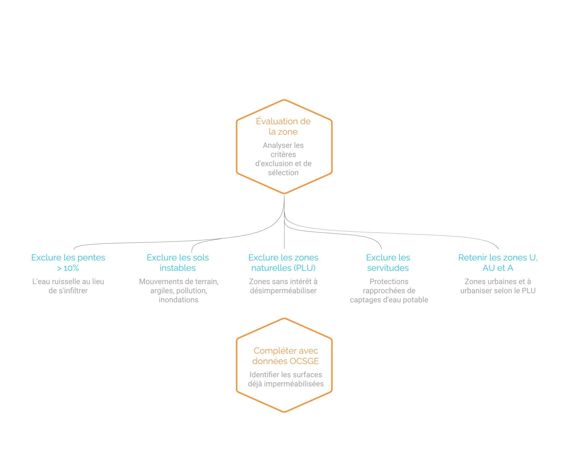

*Reconstitution partielle d'une étude réalisée avec la Métropole Nice côte d'azur & Régie eau d'azur.*

## Définition, concept

La construction des villes, l'urbanisation, et de surcroît l'imperméabilisation[^1] des sols a des conséquences sur le cycle de l'eau. En milieu urbain, l'équilibre entre le "*trop peu*" ou le "*bien trop*" d'eau est exacerbé par l'évolution du climat. En effet, l'intensité des épisodes de sécheresses, ou des épisodes pluvieux, pousse les politiques publiques d'aménagement à s'adapter, et [à s'adapter rapidement]{.underline}. Apparu fin des années 2000 au travers :

[^1]: L'imperméabilisation des sols correspond au recouvrement d'un sol par un matériau imperméable réduisant l'infiltration de l'eau, et donc son ruissellement.

- du terme ["ville-éponge" en Chine](https://www.turenscape.com/topic/en/spongecity/index.html#area3),

- d'[alternatives aux ouvrages classiques d'eaux pluviales](https://www.epa.gov/sites/default/files/2015-09/documents/bbfs1benefits.pdf) aux Etats-Unis,

- de [quartiers complétements aménagés](https://www.citego.org/bdf_fiche-document-4191_fr.html) pour gérer au mieux les eaux pluviales en Suède...

la "Ville perméable" porte bien des noms. En France Métropolitaine, nombreuses sont les villes qui ont adopté ces principes d'aménagements : - [Lyon](https://www.grandlyon.com/fileadmin/user_upload/media/pdf/eau/20170926_guide-projet-ville-permeable.pdf), - [Paris](https://www.aurba.org/wp-content/uploads/2025/08/aurba_2023_desimpermeabilisation_F_Cour_Oasis.pdf#age=3), - [Bordeaux](https://www.aurba.org/wp-content/uploads/2025/08/aurba_2023_desimpermeabilisation_F_Jardin_de_lArs.pdf), - [Nantes](https://medias-metropole.nantes.fr/s3fs-public/media/documents/NM_Plaquette%20usagers%20EP_pap%20WEB%2009%2019.pdf)

Toutes ces présenten des projets d'aménagements qui d'une part améliorent le quotidien des habitants, et d'autre part atténuent les volumes d'eaux à gérer dans les systèmes d'assainissement.

::: {.callout-note icon="true"}
## Quelle définition pour la ville perméable ?

Approche d’aménagement promouvant la gestion de l’eau de pluie [au plus près de l’endroit où elle tombe]{.underline} en réduisant les surfaces imperméables et en s'appuyant sur des solutions alternatives au tout-tuyau (par infiltration, stockage, voir réutilisation).
:::

:::: panel-tabset
## 💧​ Théorie **et** Pratique

La théorie est cette amélioration entre espaces artificialisés, et espaces naturels pour rendre [*la ville capable de gérer une plus grande quantité d'eeau de pluie*](https://www.lafabriquedelacite.com/publications/la-ville-permeable-une-solution-tombee-du-ciel/). Or en pratique, la ville est déjà bâtie, contraignant les champs d'actions sur :

1.  Le foncier sous maîtrise foncière publique,
2.  Les nouveaux espaces à construire,
3.  Les réhabilitations d'aménagements.

::: callout-important
Tout l'enjeu réside dans l'**identification des zones où il est possible d'agir** pour porter une "stratégie de ville perméable". Désimperméabiliser, et perméabiliser en amont de projets de constructions.
:::

## Quelles contraintes et sélections ?

### Une mission pour un géographe/géomaticien

Selon la méthode "EPODES" proposée par le CEREMA les critères sont ;

{width="50%"}

En détails : 1. Exclure :

- Les pentes : à plus de 10% aucune infiltration est envisageable, car l'eau ruisselle davantage qu'elle ne s'infiltre.

- Les sols : instables, soumis à mouvements de terrain. Ces sols sont parfois situés en milieu anthropisés et concerne ;

- les Plans de prévention mouvements de terrain, les porter à connaissances associés,

- Les risques de retrait et gonflement des argiles, les sols pollués, les risques inondations par remontée de nappe,

- Certaines zones avec des cartes d'aptitude à la construction... - PLU/PLU(-i) : les zones naturelles (aucun intérêt à désimperméabiliser 😉 !)

- Servitudes : protections rapprochées de captages d'eau potable

2\. Retenir : PLU/PLUi : zones "U" & "AU" voir sous conditions "A"

3\. Compléter par des données, comme l'OCSGE (IGN) : caractérisant les couvertures et usages du sol, pour identifier les surfaces déjà imperméabilisées.

Ces critères excluent [de nombreuses zones]{.underline}, mais ne suffisent pas à identifier toutes les zones d'exclusion, devant s'appuyer sur une étude de perméabilité rigoureuse et du terrain.

[Voir aussi : Infiltrabilité et imperméabilité](schema_desimperm.webp)

## Résultats

Cartographie statique à venir, en cours au 27.11.2026
::::