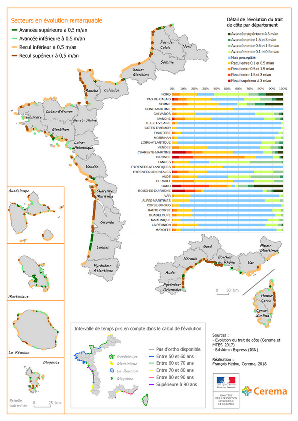

::: callout-tip
## En bref

Le CEREMA a publié cette année 2026 une seconde version de l'ndicateur national de l'érosion côtière. En Région SUD, le recul du trait de côte se localiserait sur **deux communes du Delta du Rhône**. Partout ailleurs, l'évolution est majoritairement *non perceptible*. Cette page propose un **atlas par commune** pour le visualiser, et discute ce que ces chiffres changent (ou pas) pour l'aménagement.
:::

## L'Indicateur national de l'Érosion côtière 2026

Tout récemment, le CEREMA [^1] a mis à jour la nouvelle version de l'indicateur national de l'érosion côtière. Ces résultats sont accessibles au grand public [grâce à cette application cartographique](https://cartagene.cerema.fr/portal/apps/experiencebuilder/experience/?id=9dbd12049939465481fe76a126b5298f). La première version de cet indicateur, réalisée entre 2015 et 2018, a constitué un référentiel, et les chiffres clés révisés en 2026 nous enseignent que :

[^1]: *Centre d'études et d'expertise sur les risques, l'environnement, la mobilité et l'aménagement*. [Site](https://www.cerema.fr/fr/cerema)

- **près de 20 %** des profils analysés sont en recul,
- **12 %** en avancée (phénomène d'accrétion),
- **68 %** restants ont une évolution non perceptible.

L'actualisation récente concerne davantage de profils de traits de côte, et vient confirmer qu'environ 20 % des côtes naturelles sont en recul. Pourtant, le CEREMA précise que, selon les secteurs, le littoral alterne des phases d'avancée et de recul. C'est pourquoi choisir une unique période de référence accentue les phénomènes extrêmes (tempêtes, submersions, etc.), et choisir une période allongée peut lisser ces dynamiques. Observés localement, ces travaux montrent que les réalités sont très contrastées. Qu'en est-il pour la Région SUD ?...

::: {#fig-evolution-tc-national}
{width="30%"}
:::

::: {.callout-note collapse="true"}
## Comment lire ces chiffres ?

- L'indicateur repose sur des **profils**, c'est-à-dire des points de mesure placés **tous les 50 m** le long de la côte.
- À chaque profil est associé un **taux d'évolution en mètres par an** (m/an). Négatif : le trait de côte recule. Positif : il avance.
- Entre **−0,1 et +0,1 m/an**, l'évolution est dite **non perceptible**. Ce n'est pas "stable" au sens strict : le changement est trop faible pour être distingué de l'incertitude de mesure.
- L'indicateur **ne distingue pas** une avancée naturelle d'une avancée liée à un aménagement (port, remblai, ouvrage).
:::

## En Région - Un département sur trois touché ?

Les Alpes-Maritimes et le Var ne présentent pas de phénomène de recul jugé "perceptible". En revanche, près d'**un cinquième des littoraux des Bouches-du-Rhône** entre 1950 et 2020 auraient un recul significatif (de -3 m/an jusqu'à -0,5 m/an). Ce recul tient quasi exclusivement à deux communes du Delta du Rhône.

::: callout-note
⚠️ À noter : dans les données de la @fig-evolution-tc-national, ce sont surtout les communes de [Port-Saint-Louis-du-Rhône](Atlas_littoV1/Port-Saint-Louis-du-Rh%C3%B4ne.webp){.lightbox} et de [Saintes-Maries-de-la-Mer](Atlas_littoV1/Saintes-Maries-de-la-Mer.webp){.lightbox} qui sont sévèrement touchées par le phénomène de recul du trait de côte.
:::

Ci-dessous est proposé un Atlas de cette évolution du trait de côte, simplifié. Celui-ci permet de visualiser les dynamiques littorales par commune. Au lieu de représenter les polygones de recul ou d'avancée, des linéaires contenant la dynamique du trait de côte sont mis en avant. Cette méthode a des limites significatives (voir plus bas), [et n'a pas pour objectif]{.underline} de constituer un outil d'aide à la décision.

::: panel-tabset
## Résultats

Taux moyen d'évolution du trait de côte pour chaque commune littorale (période 2010-2020). Les communes sont classées du plus fort recul au plus fort gain.

<iframe src='https://flo.uri.sh/visualisation/30729580/embed' title='Interactive or visual content' class='flourish-embed-iframe' frameborder='0' scrolling='no' style='width:100%;height:600px;' sandbox='allow-same-origin allow-forms allow-scripts allow-downloads allow-popups allow-popups-to-escape-sandbox allow-top-navigation-by-user-activation'></iframe>

- **Deux communes se détachent nettement** : Port-Saint-Louis-du-Rhône et Saintes-Maries-de-la-Mer sont les deux communes du Delta citées plus haut.
- **La grande majorité des communes ont peu de recul (-0.1 à +0.1)** : leur évolution moyenne est peu ou pas perceptible.
- **Certaines communes affichent une avancée** (Fos-sur-Mer, par exemple, autour de +0,17 m/an). 

Attention : l'indicateur est sur la période 2010-2020, et ne distingue pas une avancée naturelle d'une avancée due aux aménagements (ex: brises-lames, zones portuaires, etc...).

## Atlas des communes littorales (Région SUD)

Cliquer sur une vignette pour l'agrandir, puis naviguer de commune en commune.

```{python}
#| echo: false
#| output: asis
from pathlib import Path

images = sorted(Path("Atlas_littoV1").glob("*.webp"))

# Grille de vignettes : change 7 pour 5 ou 6 si elles sont trop petites
print("::: {layout-ncol=7}\n")
for img in images:
    commune = img.stem.replace("_", " ") #permet d'avoir le nom de la commune et mets des espaces à la place des "_"
    # group="communes" : toutes les images sont reliées dans la visionneuse
    print(f'} "{commune}"){{group="communes"}}\n')
print(":::")
```
## Les limites de cette méthode

Cet atlas est une simplification. Quelques précautions :

- **Les lignes sont des repères, pas la côte elle-même** : elles sont construites à partir du centre des polygones d'évolution, donc décalées du trait de côte réel.
- **Une moyenne par commune cache des réalités opposées** : sur un même linéaire, un secteur en recul et un secteur en avancée peuvent s'annuler.
- **Les petits linéaires pèsent peu** : certaines communes sont représentées par très peu de profils (quelques unités), leur moyenne est donc fragile.
- **Des tronçons non calculés** peuvent être "traversés" par les lignes.
- **Mes classes de légende (±0,2 m/an) ne sont pas celles du CEREMA (±0,1 m/an)** : à garder en tête en comparant avec Cartagène.

## Carte interactive

Carte interactive en cours de préparation.
:::


### Et l'aménagement dans tout ça ?

Le recul du trait de côte est devenu un sujet de planification. Dans le cadre de la loi Climat et Résilience, une liste de communes particulièrement exposées est fixée par décret. Ces communes doivent établir des **cartes locales d'exposition au recul du trait de côte**, qui projettent l'érosion à 30 ans puis entre 30 et 100 ans, et les intégrer à leurs documents d'urbanisme (PLU).

Dans les Bouches-du-Rhône, le décret [2022-750 du 29 avril 2022](https://www.legifrance.gouv.fr/loda/id/JORFTEXT000045726134) retient six communes : **Arles, Cassis, La Ciotat, Marseille, Port-de-Bouc et Sausset-les-Pins**.

::: callout-important
## Un décalage à interroger

Les deux communes qui reculent le plus dans l'indicateur 2010-2020, **Port-Saint-Louis-du-Rhône** et **Saintes-Maries-de-la-Mer**, ne figurent pas dans cette liste. À l'inverse, les six communes listées présentent des évolutions moyennes non perceptibles sur la même période.
:::

Ce décalage ne signifie pas qu'il y a une erreur. L'indicateur mesure **le passé** sur une période donnée, alors que les cartes locales portent sur **des projections** et sur des enjeux (bâti, activités, submersion marine) que la seule vitesse de recul ne résume pas. Reste à comprendre, au cas par cas, ce qui explique les choix de la liste.

## En conclusion : la mer monte, vraiment ?

À l'échelle de la Région SUD, la réponse est **nuancée** : le recul du trait de côte est réel mais très **concentré**, surtout sur le Delta du Rhône, alors que la majorité des communes littorales présente une évolution non perceptible sur la période étudiée. Une lecture communale permet d'en prendre conscience vite, mais ne remplace ni les données détaillées, ni l'expertise locale pour décider d'un aménagement.

## Données, outils et transparence

- **Données** : Indicateur national de l'érosion côtière – version 2026, CEREMA. *Source : Indicateur national de l'érosion côtière – Version 2026 – Cerema, 2026.*
- **Outils** : QGIS, Excel, Python (génération de l'Atlas), Quarto.